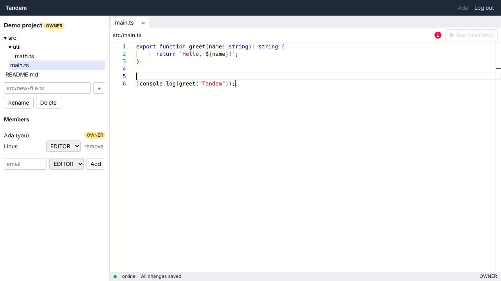
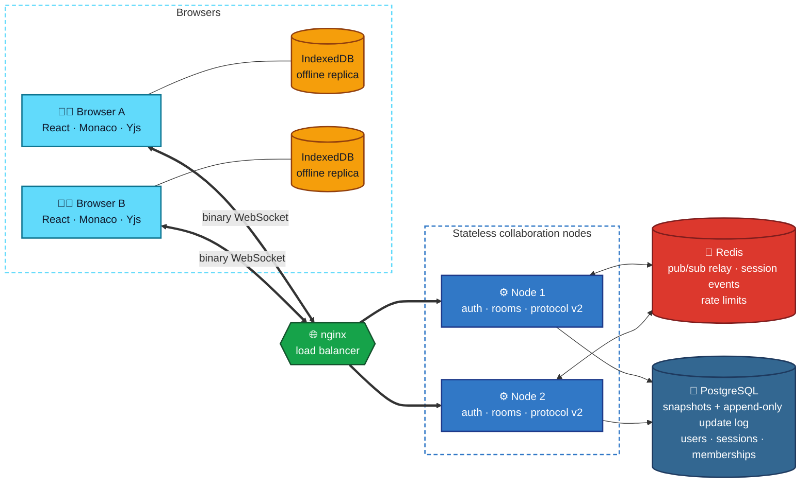
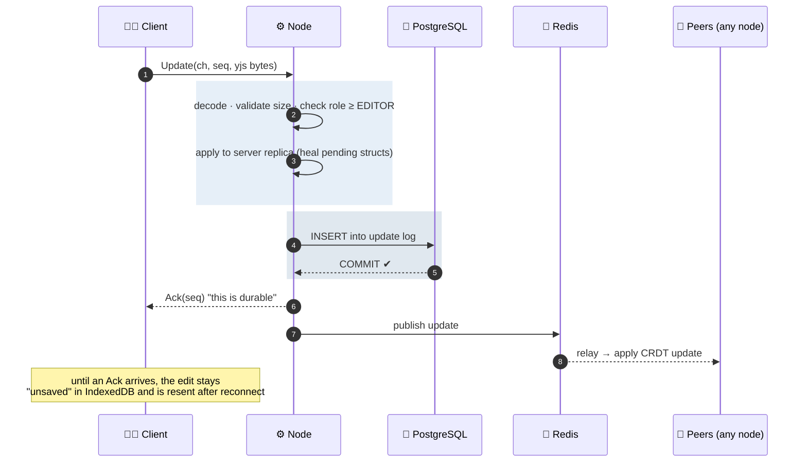
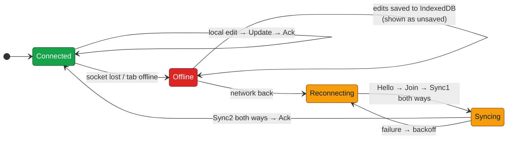
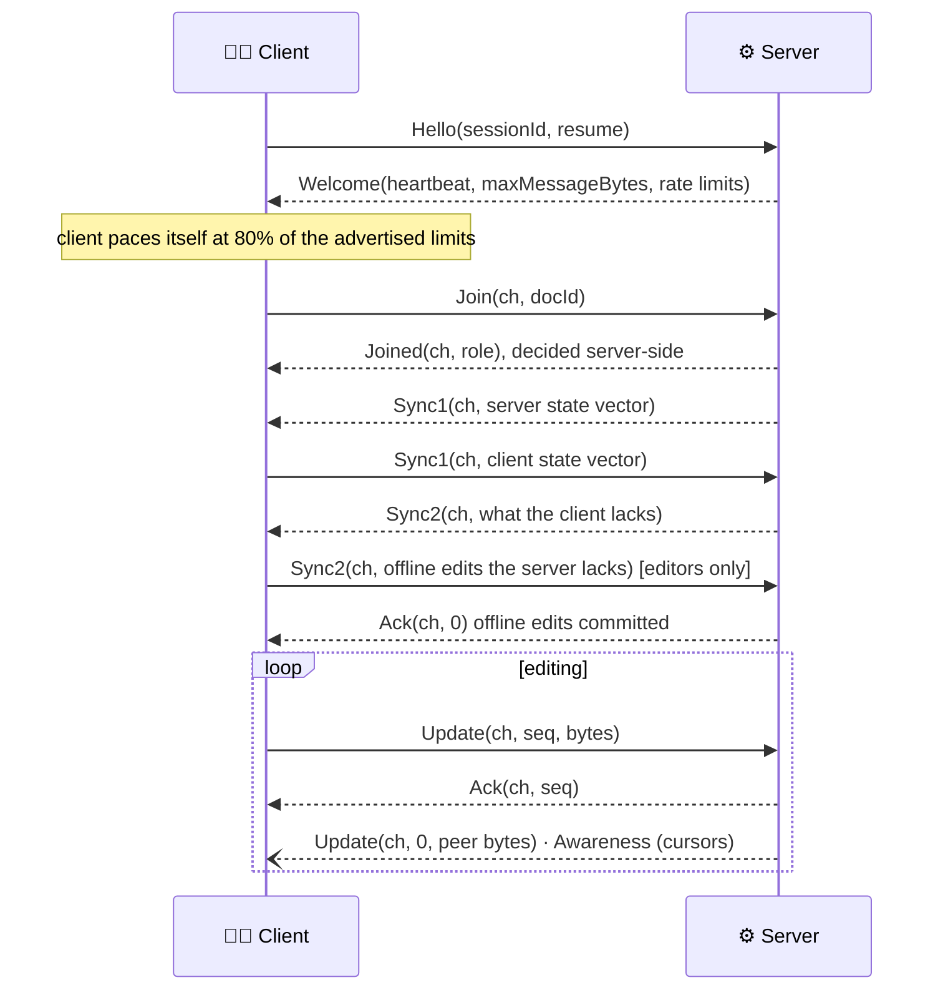
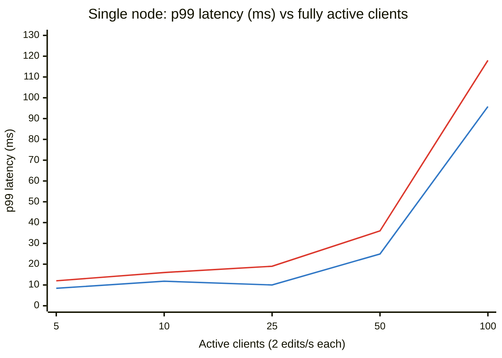

<div align="center">

# ✍️ Tandem

### A real-time collaborative code editor that survives offline edits, node crashes and database outages without losing a keystroke

**Yjs CRDT · binary WebSocket protocol · ACK-after-commit durability · offline-first IndexedDB · multi-node via Redis · PostgreSQL snapshots + update log**

<br/>


[](https://github.com/siddhaantxsingh/TANDEM-Collaborative-Editor/actions/workflows/ci.yml)


[**Architecture**](#%EF%B8%8F-architecture) · [**Durability**](#-ack-means-postgresql-commit) · [**Offline**](#-offline-first) · [**Protocol**](#-wire-protocol-v2) · [**Failure testing**](#-failure-testing) · [**Load**](#-load-testing) · [**Security**](#%EF%B8%8F-security) · [**Run it**](#-quick-start)

</div>

---



<sub>Workspace with a file tree, OWNER/EDITOR/VIEWER roles, Monaco with a remote collaborator's cursor, and a live "online · All changes saved" status. **Run is disabled on purpose**: there is no safe sandbox, so there is no code execution.</sub>

---

## 📌 TL;DR

A demo can sync two textareas over a WebSocket in an afternoon. Tandem is built around the questions that come after that:

| Question | Tandem's answer |
|---|---|
| Two users edit the same spot? | **Yjs CRDT**: every replica converges, with no last-write-wins |
| Duplicated, reordered or dropped messages? | CRDT updates are idempotent and commutative; **state-vector resync** repairs gaps |
| Client offline for ten minutes, or the browser restarts? | Local replica in **IndexedDB**; unsaved edits survive reloads and merge on reconnect |
| Server says "saved", then crashes? | **ACK is only sent after the PostgreSQL commit.** Tested with `kill -9` |
| PostgreSQL goes down? | ACKs are withheld, edits are held and then committed when it returns |
| A node dies mid-rolling-deploy? | Clients reconnect to another node; **Redis** relays across nodes; state lives in PostgreSQL |
| 1,000 clients reconnect at once? | All rejoined in ≤ 3.0 s, all offline edits saved and converged in ≤ 3.3 s |
| Someone logs out on another device? | Sessions are revoked **on every node** and live sockets close |

---

## 🏗️ Architecture



| State | Lives in | Why |
|---|---|---|
| Document history | PostgreSQL: snapshots + append-only updates | durability with bounded replay ([ADR-004](docs/adr/004-snapshot-plus-log.md)) |
| Local replica | IndexedDB | survives reloads and browser restarts ([ADR-008](docs/adr/008-offline-indexeddb.md)) |
| Cross-node relay | Redis pub/sub | node-to-node propagation ([ADR-006](docs/adr/006-multinode-redis.md)) |
| Presence / cursors | memory + Redis | ephemeral by design |
| Auth, sessions, roles | PostgreSQL (+ Redis events) | shared security state, enforced server-side ([ADR-005](docs/adr/005-server-side-authorization.md)) |

<details>
<summary><b>📦 Monorepo packages</b></summary>

<br/>

| Package | Contents |
|---|---|
| [`packages/protocol`](packages/protocol) | Binary codec shared by browser and server · client sync state machine |
| [`packages/server`](packages/server) | HTTP API, auth, WebSocket handling, rooms, Redis bus, persistence, rate limits, metrics |
| [`packages/client`](packages/client) | React + Monaco UI, workspace view, IndexedDB sync, service worker |
| [`e2e/`](e2e) | Playwright browser tests |
| [`tools/`](tools) | Load test, chaos test, kill -9 crash test, deployment smoke test |

</details>

---

## 🔒 ACK means PostgreSQL commit

Not "the server received the packet": **committed**. This is the central durability invariant ([ADR-003](docs/adr/003-ack-after-persist.md)).



> **This invariant caught a real bug.** A random-schedule property test found an update that was **acknowledged but never written** to PostgreSQL (P10). Yjs merges new pending structs into an existing pending object *in place*, and the server compared object identity. The fix and its failing-first regression test are in [`AUDIT_2026-10-14.md`](docs/AUDIT_2026-10-14.md).

---

## 📴 Offline-first



Reconnect **exchanges state vectors** ("this is what I have") and only the missing updates flow each way. The local document is never replaced by a server copy, so offline work can't be overwritten. Playwright covers **reload while offline** and **browser restart while offline**: edits survive, show as unsaved, and are saved after reconnecting.

---

## 📡 Wire protocol (v2)

Explicit and binary ([ADR-002](docs/adr/002-explicit-binary-protocol.md)). Every frame is `[u8 version = 2][u8 type][payload]`, with lib0 varUints and length-prefixed fields. Text frames close the connection. One socket multiplexes many documents through **channels**.



Large messages are split into **Fragments** (≤ 256 KiB each). There are 10 structured error codes, plus close codes for rate limiting (4008), backpressure (4009), being superseded by a newer connection (4010) and a revoked session (4001). Version mismatches get an error **in the sender's own version**, so an old tab is told to reload. Full spec: [`PROTOCOL.md`](docs/PROTOCOL.md)

---

## 💥 Failure testing

### `kill -9` during writes (`tools/crash-ack.ts`)

Six clients write continuously while the harness **SIGKILLs the server, or PostgreSQL**, 12 times. After every cycle, every acknowledged insert must be in the database.

| Cycles | Sent | Acknowledged | **Acked but missing** | Unacked but stored anyway |
|:---:|:---:|:---:|:---:|:---:|
| 12 (server · pg · pg-recover) | 7,149 | 3,706 | **0** | 337 (allowed: the client never got a promise) |

**The test itself was mutation-tested.** With ACK moved to "on receipt" instead of "after commit", it reports **1,376 acknowledged inserts missing.**

### Chaos with real node processes


### Full failure matrix

| Scenario | Result |
|---|---|
| Concurrent edits at the same position | ✅ converged |
| Duplicate / reordered frames | ✅ idempotent, converged |
| 30% silent frame loss | ✅ recovered through resync |
| Offline edits, reload, browser restart | ✅ saved and merged |
| **Offline property test**: 200 random schedules, 2–5 clients, 2 nodes, dup/reorder/delay faults | ✅ all replicas **and** PostgreSQL identical (content, state vector, canonical bytes) |
| Node SIGKILL · Redis restart · rolling restart | ✅ recovered, durable |
| PostgreSQL outage | ✅ ACKs withheld; edits committed after recovery |
| PostgreSQL connection lost mid-transaction | ✅ fixed: it used to **crash the node** (unhandled pool-client `error`) |
| Chaos runs, 2026-10-05 + 2026-10-14 | ✅ **25,000+ inserts, 0 missing, 0 duplicated**, DB == replicas |
| Backup → restore | ✅ 31/31 documents restored |

---

## 📊 Load testing

Each simulated client is a **full Yjs replica** over a real WebSocket, making 2 edits/s. After every run: wait for zero unsaved edits → check all replicas are identical → **reconnect storm** → compare every document with the database. *Every row passed every check.*


<sub>🟦 propagation p99 (edit → seen by a peer) · 🟥 durable-ACK p99 (edit → PostgreSQL commit → Ack)</sub>

| Load | Edits/s | Propagation p99 | Durable ACK p99 | Server CPU | Peak RSS |
|---|:---:|:---:|:---:|:---:|:---:|
| **100 fully active clients** | 191 | **95.8 ms** | **118 ms** | 19.2% | 119 MiB |
| **1,000 connected, 100 editing** | 193 | **28.4 ms** | **62 ms** | 19.4% | 124 MiB |
| **1,000-client reconnect storm** | — | all rejoined ≤ **3.0 s** | all offline edits saved ≤ **3.3 s** | — | — |

> [!NOTE]
> Server, PostgreSQL, Redis **and** the load generator all shared one 2-vCPU VM. Above about 100 fully active clients the *generator* saturates the machine, so the 500–1,000-client rows show **correctness under overload, not capacity**. The 2-node runs prove the multi-node path stays correct; **horizontal throughput scaling is not claimed.** Full table and method: [`PERFORMANCE.md`](docs/PERFORMANCE.md)

---

## 🛡️ Security

| Area | Controls |
|---|---|
| **AuthN** | scrypt password hashing · hashed session tokens · `httpOnly` cookies · session expiry |
| **Session revocation** | Logout, log-out-everywhere, expiry and admin revocation close live sockets **on every node** (Redis event + per-socket timer + periodic revalidation) |
| **AuthZ** | OWNER / EDITOR / VIEWER enforced **server-side** on every HTTP route, WebSocket join and update · IDOR and privilege-escalation tests · "not found" for no access, so documents can't be enumerated |
| **Web** | CSRF protection · strict CSP · cross-site WebSocket `Origin` rejection |
| **Abuse** | Rate limits (HTTP + per-socket message/byte budgets) · message size and queue limits · backpressure disconnects · `MAX_CONNECTIONS` |
| **Ops** | Protected `/metrics` · audit log · request IDs · graceful shutdown · non-root, read-only, capability-dropped container |
| **No code execution** | **"Run" is disabled by design.** A `child_process` call isn't a sandbox ([ADR-007](docs/adr/007-no-code-execution.md)) |

Details: [`SECURITY.md`](docs/SECURITY.md)

---

## 🧪 Test suite

| Layer | What |
|---|---|
| **100 Vitest tests** | codec + fuzz · CRDT properties · convergence under a fault-injecting network · multi-node · sessions · auth · security · limits · regressions · DB resilience |
| **fast-check property tests** | Random offline/online schedules across nodes, with **byte-level** replica and DB checks |
| **3 Playwright E2E** | Two users collaborating live with offline merge and read-only viewers · reload while offline · browser restart while offline |
| **Tools** | `crash-ack.ts` (kill -9) · `chaos.ts` · `loadtest.ts` / `loadmatrix.sh` · `deploy-smoke.sh` (19 production-style checks) |
| **CI** | Typecheck → all tests → E2E → smoke + load (convergence + DB agreement) → crash test → chaos test → non-root image check |

---

## 🚀 Quick start

```bash
cp .env.example .env              # change every value
docker compose up --build         # PostgreSQL + Redis + 2 nodes + nginx → http://localhost:8080
```

<details>
<summary><b>🛠️ Development & tests</b></summary>

<br/>

```bash
npm ci
npm run build
npm run typecheck
npx vitest run          # needs PostgreSQL + Redis (TEST_DATABASE_ADMIN_URL, TEST_REDIS_URL)
npx playwright test     # CHROMIUM_PATH=... if your Chromium build differs

npx tsx tools/crash-ack.ts --mode server   # kill -9 during writes
npx tsx tools/chaos.ts                     # multi-node chaos
tools/loadmatrix.sh                        # load matrix
tools/deploy-smoke.sh                      # production-style smoke test
```

</details>

---

## 🧭 Design decisions

| ADR | Decision |
|---|---|
| [001](docs/adr/001-crdt-yjs.md) | **Yjs CRDT** over operational transformation |
| [002](docs/adr/002-explicit-binary-protocol.md) | An explicit, versioned **binary protocol** |
| [003](docs/adr/003-ack-after-persist.md) | **ACK after persist** |
| [004](docs/adr/004-snapshot-plus-log.md) | **Snapshot + append-only log** for bounded replay |
| [005](docs/adr/005-server-side-authorization.md) | **Server-side authorization** on every message |
| [006](docs/adr/006-multinode-redis.md) | **Multi-node** through a Redis relay |
| [007](docs/adr/007-no-code-execution.md) | **No code execution** without a real sandbox |
| [008](docs/adr/008-offline-indexeddb.md) | **Offline-first** with IndexedDB |

More: [Architecture](docs/ARCHITECTURE.md) · [Correctness argument](docs/CORRECTNESS.md) · [Testing](docs/TESTING.md) · [Deployment](docs/DEPLOYMENT.md) · [Audit](docs/AUDIT_2026-10-14.md)

---

## ⚠️ Limitations

- **No production traffic or live demo.** All results come from local and CI runs on shared machines.
- **Horizontal throughput scaling is not demonstrated** (both nodes shared 2 vCPUs).
- No MFA or password recovery, no end-to-end encryption, no external penetration test.
- **CRDT only.** Operational transformation is not implemented, and there's no semantic conflict detection.
- The Docker image wasn't rebuilt in the latest audit (disk full). The earlier deploy smoke run used a local stand-in for the official Node base image.

---

<div align="center">

**A collaborative editor is easy to demo.**
**Tandem is about making collaboration converge, persist, recover and survive failure.**

<br/>

Built by **[Siddhant Singh](https://github.com/siddhaantxsingh)** · <sub>MIT License</sub>

</div>
