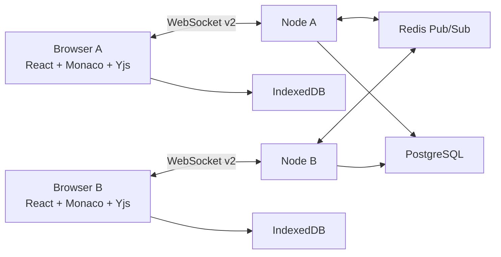
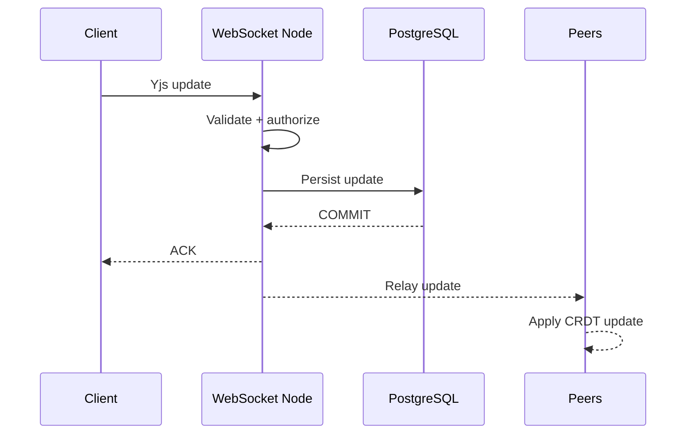
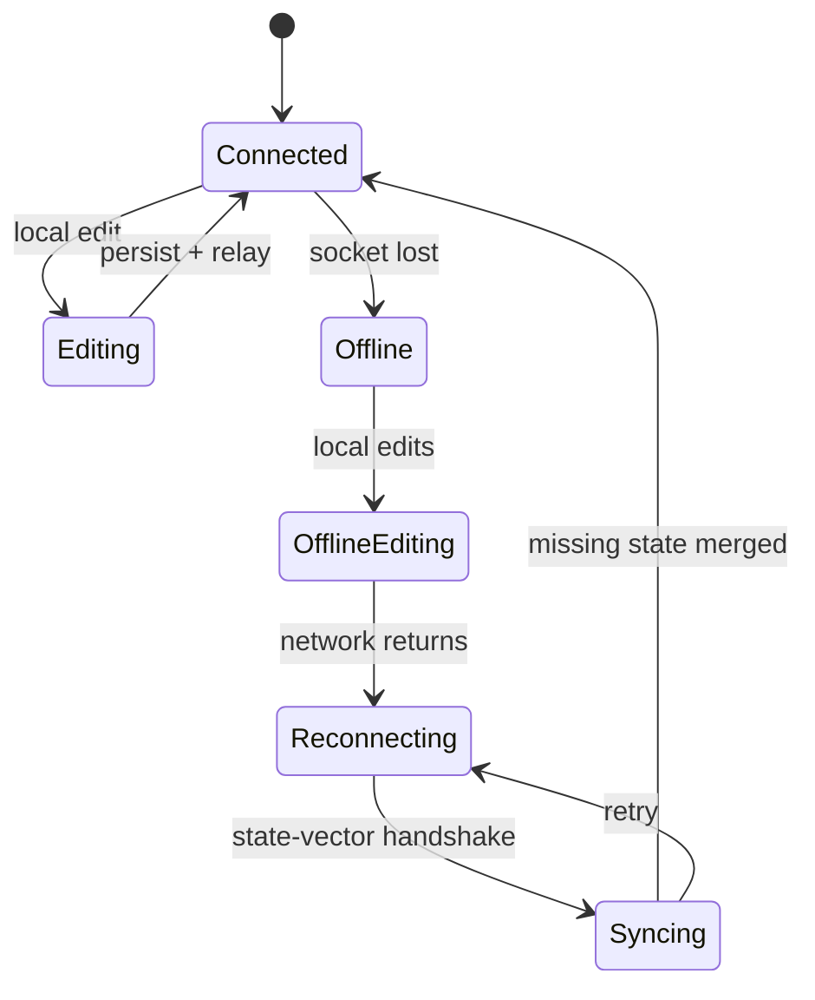
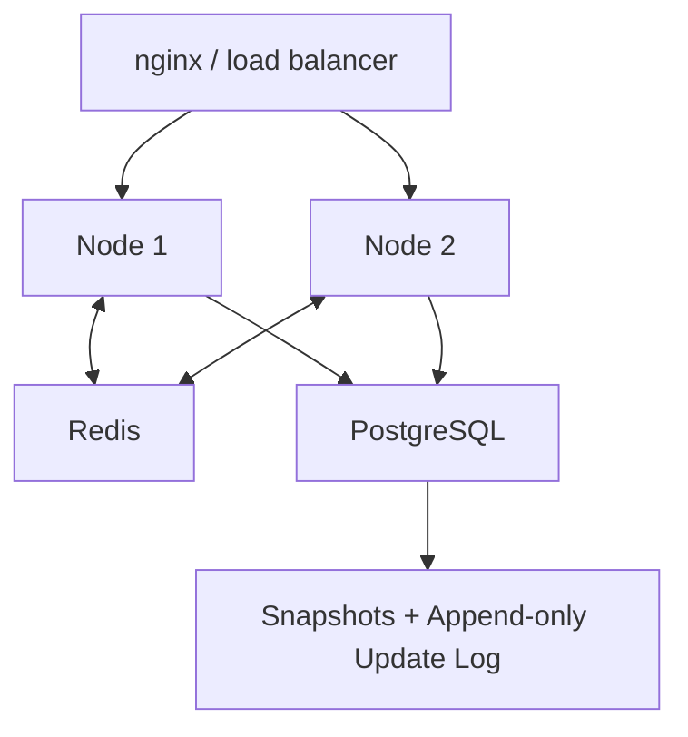

<div align="center">
<h1>Tandem</h1>

<h3>A fault-tolerant, offline-first real-time collaborative code editor.</h3>

<p>


</p>
**Concurrent editing · offline-first · durable acknowledgements ·
multi-node synchronization · failure recovery**
</div>

------------------------------------------------------------------------

## ✦ The problem

Real-time collaborative editing is deceptively hard.

A demo can synchronize two textareas with a WebSocket in an afternoon.

A useful collaboration system must answer much harder questions:

-   What happens when two users edit the same position?
-   What if messages arrive twice?
-   What if they arrive out of order?
-   What if a client goes offline for ten minutes?
-   What if the server acknowledges an edit and then crashes?
-   What if PostgreSQL is unavailable?
-   What if Redis restarts?
-   What if a node dies during a rolling deployment?
-   What if 1,000 clients reconnect simultaneously?

**Tandem is built around those questions.**

------------------------------------------------------------------------

## 🖥️ Product


Tandem provides:

-   Monaco editor
-   file tree and tabs
-   multi-user editing
-   remote cursors
-   presence avatars
-   workspaces
-   OWNER / EDITOR / VIEWER roles
-   offline editing
-   reconnect and state-vector synchronization
-   durable persistence
-   multi-node server architecture

There is intentionally **no server-side code execution**. The project
does not pretend an unsafe `child_process` feature is a sandbox.

------------------------------------------------------------------------

## 🧭 Architecture



### What belongs where?

  State                   System               Why
  ----------------------- -------------------- --------------------------
  Document state          Yjs / PostgreSQL     correctness + durability
  Snapshots               PostgreSQL           bounded replay
  Append-only updates     PostgreSQL           durable synchronization
  Presence                memory / Redis       ephemeral
  Local offline replica   IndexedDB            survive reload/restart
  Cross-node relay        Redis                node-to-node propagation
  Auth/session limits     PostgreSQL + Redis   shared security state

------------------------------------------------------------------------

## 🧬 Collaboration algorithm



### The durability invariant

> **ACK means PostgreSQL commit.**

Not:

> "The server received the packet."

This is encoded in the architecture and tested during database-outage
scenarios.

------------------------------------------------------------------------

## 🔄 Offline-first synchronization



Every document replica can survive:

-   socket loss
-   browser reload
-   browser restart
-   temporary server failure

Reconnect uses a state-vector synchronization path rather than replacing
the local document with a stale server copy.

------------------------------------------------------------------------

## 🧠 Why CRDT?

Tandem uses **Yjs / YATA**, not last-write-wins document replacement.

The system explicitly exercises:

-   convergence
-   idempotence
-   commutativity
-   duplicate delivery
-   reordering
-   dropped frames
-   delayed frames
-   stale replicas
-   offline edits
-   reconnect storms

The hardening pass also found a Yjs liveness edge case where pending
items could remain despite their dependencies arriving. A healing apply
is used consistently, and the regression is covered by tests.

------------------------------------------------------------------------

## 🌐 Multi-node design



The collaboration nodes are designed to be stateless with respect to
durable document history.

Two-node correctness was tested with Redis relay and shared PostgreSQL.

**Horizontal throughput scaling was not claimed** because both nodes and
the generator shared the same 2-vCPU machine.

------------------------------------------------------------------------

## 🛡️ Security model

Server-side authorization is enforced on HTTP endpoints and WebSocket
joins/updates.

Included:

-   OWNER / EDITOR / VIEWER authorization
-   IDOR protection
-   privilege-escalation tests
-   scrypt password hashing
-   hashed session tokens
-   `httpOnly` cookies
-   CSRF protection
-   cross-site WebSocket origin checks
-   strict CSP
-   rate limiting
-   message and queue limits
-   protected metrics
-   audit logging
-   request IDs
-   graceful shutdown
-   no code execution

### Deliberate security decision

``` text
"Run Code"
     │
     ▼
No safe sandbox available
     │
     ▼
FEATURE DISABLED
```

This is a security feature, not a missing TODO.

------------------------------------------------------------------------

## 🧪 Correctness & failure matrix

  Scenario                       Result
  ------------------------------ --------------------------------------
  Concurrent edits               Converged
  Duplicate frames               Idempotent
  Reordered frames               Converged
  30% silent loss                Recovered via resync
  Offline edits                  Recovered and merged
  1,000-client reconnect storm   All rejoined and converged
  Node SIGKILL                   Recovered
  Redis restart                  Recovered
  PostgreSQL outage              Acks withheld; edits later committed
  Rolling restart                Converged + durable
  Backup / restore               31/31 documents restored

The final hardening pass recorded **88/88 Vitest tests** and **3/3
browser E2E scenarios** passing. The 2026-10-14 audit
([`docs/AUDIT_2026-10-14.md`](docs/AUDIT_2026-10-14.md)) added session
revalidation, an offline property test with byte-level replica checks and
a kill -9 crash test; it found and fixed an acknowledged-but-unstored
update (P10) and a node crash on PostgreSQL connection loss. Now:
**100 Vitest tests, 3/3 E2E** (`docs/evidence/2026-10-14/final-tests.log`).

| 2026-10-14 check | Result |
| --- | --- |
| Offline property, 200 random schedules, 2 nodes | all replicas and PostgreSQL identical (content, state vector, bytes) |
| Crash: server and PostgreSQL kill -9 during writes, 12 cycles | 3,706 acks, 0 missing |
| Chaos with real node processes, 2 runs | 7,160 / 7,088 inserts, 0 lost |
| Logout / revoked / expired session | live sockets closed on every node |
| Load, 50 editors, shared 4-vCPU machine (load avg 23-30) | propagation p50 25-44 ms (1 node), 74-166 ms (2 nodes); p99 0.3-1.4 s |

------------------------------------------------------------------------

## 📊 Load testing

All results below are from the recorded 2026-10-05 runs on a **2-vCPU
VM** shared by the server, databases, Redis, nginx where applicable, and
load generator.

### Healthy operating range

At **100 fully active clients**:

-   ≈191 edits/s achieved
-   propagation p99: **95.8 ms**
-   durable ACK p99: **118 ms**
-   server CPU: **19.2%**
-   peak RSS: **119 MiB**

### 1,000 connected / 100 editing

-   ≈193 edits/s
-   propagation p99: **28.4 ms**
-   durable ACK p99: **62 ms**
-   peak RSS: **124 MiB**

### Reconnect storm

At 1,000 simultaneous reconnects:

-   all clients rejoined in ≤ **3.0 s**
-   all offline edits saved + converged in ≤ **3.3 s**

### Important interpretation

At 500--1,000 fully active clients, the load generator saturated the
shared 2-vCPU machine. Those rows demonstrate **correctness under
overload**, not server capacity.

------------------------------------------------------------------------

## 💥 Chaos testing

``` mermaid
flowchart LR
    A["Healthy cluster"] --> B["Inject partition"]
    B --> C["Inject latency"]
    C --> D["Drop / reorder traffic"]
    D --> E["SIGKILL node"]
    E --> F["Restart node"]
    F --> G["Redis restart"]
    G --> H["PostgreSQL outage"]
    H --> I["Heal faults"]
    I --> J["Verify convergence"]
    J --> K["Verify database == replicas"]
```



Recorded chaos:

-   2 runs
-   8 clients
-   2 nodes
-   network partition
-   200 ms latency injection
-   reconnect storm
-   node SIGKILL
-   Redis restart
-   PostgreSQL outage

Across the recorded runs:

> **11,800 inserts · 0 missing · 0 duplicated · converged · DB matched**

------------------------------------------------------------------------

## 🚀 Deployment

The deployment stack includes:

``` text
nginx
  │
  ├── Node 1
  └── Node 2
       │
       ├── Redis
       └── PostgreSQL
```

The production-style smoke test covers:

-   19 deployment checks
-   non-root image
-   read-only root filesystem
-   dropped capabilities
-   health endpoints
-   CSP
-   cookie flags
-   CSRF
-   cross-origin WebSocket rejection
-   IDOR
-   authenticated edit
-   rolling restart
-   backup + restore

The recorded image used a local stand-in for the official Node base
because Docker Hub was blocked in the validation environment. This is
explicitly documented and not presented as an official-base
verification.

------------------------------------------------------------------------

## 🧰 Quick start

``` bash
npm ci
npm run build
npm run typecheck
npx vitest run          # needs PostgreSQL + Redis (TEST_DATABASE_ADMIN_URL, TEST_REDIS_URL)
npx playwright test     # CHROMIUM_PATH=... if the installed Chromium build differs
npx tsx tools/crash-ack.ts --mode server   # kill -9 during writes
```

Docker:

``` bash
docker compose up --build
```

Useful tools:

``` bash
tools/loadmatrix.sh
tools/chaos.ts
tools/deploy-smoke.sh
tools/pending-check.ts
```

------------------------------------------------------------------------

## 📚 Documentation

  ------------------------------------------------------------------------------------------------
  Area                                Link
  ----------------------------------- ------------------------------------------------------------
  Architecture                        [`docs/ARCHITECTURE.md`](docs/ARCHITECTURE.md)

  Protocol                            [`docs/PROTOCOL.md`](docs/PROTOCOL.md)

  Correctness                         [`docs/CORRECTNESS.md`](docs/CORRECTNESS.md)

  Security                            [`docs/SECURITY.md`](docs/SECURITY.md)

  Testing                             [`docs/TESTING.md`](docs/TESTING.md)

  Performance                         [`docs/PERFORMANCE.md`](docs/PERFORMANCE.md)

  Deployment                          [`docs/DEPLOYMENT.md`](docs/DEPLOYMENT.md)

  Audits                              [`docs/ARCHITECTURE_AUDIT.md`](docs/ARCHITECTURE_AUDIT.md) ·
                                      [`docs/HARDENING_AUDIT.md`](docs/HARDENING_AUDIT.md) ·
                                      [`docs/FINAL_AUDIT.md`](docs/FINAL_AUDIT.md)

  ADRs                                [`docs/adr/`](docs/adr/)

  2026-10-14 audit                    [`docs/AUDIT_2026-10-14.md`](docs/AUDIT_2026-10-14.md) ·
                                      [`docs/REQUIREMENTS_MATRIX.md`](docs/REQUIREMENTS_MATRIX.md) ·
                                      [`docs/OWNER_ACTIONS.md`](docs/OWNER_ACTIONS.md)
  ------------------------------------------------------------------------------------------------

------------------------------------------------------------------------

## 🚧 Honest limitations

Not claimed:

-   real production traffic
-   horizontal throughput scaling
-   external penetration testing
-   MFA/password recovery
-   end-to-end encryption
-   semantic conflict detection
-   code execution
-   formal verification
-   operational transformation (only the Yjs CRDT is used)
-   a verified Docker build in the 2026-10-14 audit (disk was full; see
    [`docs/OWNER_ACTIONS.md`](docs/OWNER_ACTIONS.md))

The project's correctness claims are **test-backed guarantees**, not
formal proofs.

------------------------------------------------------------------------

<div align="center">
### A collaborative editor is easy to demo.

### Tandem is about making collaboration converge, persist, recover, and survive failure.
</div>
