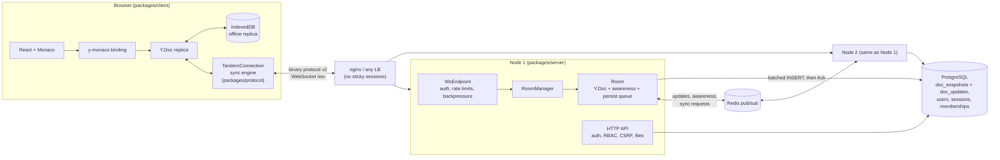

# Tandem

A real-time collaborative code editor that keeps working offline and on more than one server node. Built on the Yjs CRDT, a versioned binary WebSocket protocol, PostgreSQL and Redis.

[](https://github.com/siddhaantxsingh/TANDEM-Collaborative-Editor/actions/workflows/ci.yml?query=branch%3Accr-a6e6c567-y4w7k8)


[](LICENSE)


Monaco editor, file tree and tabs, remote cursors and presence, workspaces with OWNER / EDITOR / VIEWER roles, offline editing through IndexedDB, and a server that only acknowledges an edit after PostgreSQL has committed it. There is deliberately no "run code" feature, because there is no safe sandbox for it ([ADR-007](docs/adr/007-no-code-execution.md)).

## Highlights

- **"ACK means PostgreSQL commit", tested with kill -9.** Across 12 crash cycles that SIGKILL the server or PostgreSQL during writes, 3,706 acknowledged edits were sent and 0 were missing from the database. A mutant that acks on receipt loses 1,376 ([`crash-ack.log`](docs/evidence/2026-10-14/crash-ack.log), [`crash-ack-mutation.log`](docs/evidence/2026-10-14/crash-ack-mutation.log)).
- **Offline edits converge byte for byte.** A fast-check property test runs 2–5 clients over 2 nodes with offline periods and duplicated, reordered and delayed frames. In 200/200 schedules, every client, both server replicas and PostgreSQL had the same content, state vector and canonical bytes ([`offline-property.log`](docs/evidence/2026-10-14/offline-property.log)).
- **Multi-node chaos with real processes.** 2 nodes behind Redis, with SIGKILL of each node, a Redis restart and a PostgreSQL SIGKILL: 7,160 and 7,088 inserts in two runs, 0 missing or duplicated, database matching the replicas ([`chaos-multinode.log`](docs/evidence/2026-10-14/chaos-multinode.log)).
- **Revoked sessions lose their sockets on every node.** Logout, expiry, admin revocation and permission changes close or downgrade live WebSockets, even if the Redis event is lost (revalidation every 30 s). 7 of 9 of these tests failed before the fix.
- **Measured load profile.** On a 2-vCPU VM shared with the databases and the load generator, 100 fully active clients on one node (≈ 191 edits/s) saw propagation p99 95.8 ms and durable-ack p99 118 ms at 19.2 % server CPU ([PERFORMANCE.md](docs/PERFORMANCE.md)).
- **Real bugs found by the tests.** An update with missing dependencies could be acked but never stored (P10), and a lost PostgreSQL connection could crash the node (R1). Both have failing-first logs and regression tests ([audit](docs/AUDIT_2026-10-14.md)).

## Architecture



A keystroke becomes a Yjs transaction in the browser. The sync engine sends it as a numbered `Update` frame. On the server, `WsEndpoint` rate-limits and decodes the frame, and `Room` checks the role, validates the update's structure and applies it. The effective update is relayed to local clients and published on Redis for other nodes; relaying does not wait for the database. The persist loop writes updates in batches to the append-only `doc_updates` table and sends `Ack(seq)` only after the commit. Compaction later merges the log into `doc_snapshots` under an advisory lock. On reconnect, client and server exchange state vectors so each side sends only what the other is missing. Full write and read paths: [ARCHITECTURE.md](docs/ARCHITECTURE.md), wire format: [PROTOCOL.md](docs/PROTOCOL.md).

## Quick start

Requires Node 20+ (CI uses 22), plus PostgreSQL 16 and Redis 7 for the server tests.

```bash
git clone https://github.com/siddhaantxsingh/TANDEM-Collaborative-Editor.git
cd TANDEM-Collaborative-Editor
npm ci
npm run build
npm run typecheck
```

Tests (as in CI):

```bash
export TEST_DATABASE_ADMIN_URL=postgres://postgres@127.0.0.1:5432/postgres
export TEST_REDIS_URL=redis://127.0.0.1:6379
npx vitest run                                    # unit, integration, property, fuzz
npx playwright install chromium && npx playwright test   # browser E2E
npx tsx tools/crash-ack.ts --cycles 4 --clients 4 --mode server   # kill -9 during writes
npx tsx tools/chaos.ts                            # multi-node fault injection
```

Run the full two-node stack (PostgreSQL, Redis, two app nodes, nginx on port 8080):

```bash
cp .env.example .env        # set POSTGRES_PASSWORD and METRICS_TOKEN
docker compose up --build -d
curl -fs http://localhost:8080/health/ready
scripts/demo.sh http://localhost:8080   # seeds two demo users sharing a workspace
```

Then open http://localhost:8080 in two browsers and log in as the two users the script prints.

## Results

### Load (2026-10-05, one 2-vCPU VM shared by server, PostgreSQL, Redis and load generator)

Each client is a full Yjs replica editing at 2 edits/s, 10 clients per document. Every row converged, with the database identical to the clients.

| Nodes | Clients (editing) | Edits/s | Propagation p50 / p99 | Durable ack p99 | Server CPU | Peak RSS |
|---:|---:|---:|---|---:|---:|---:|
| 1 | 50 | 97 | 3.0 / 24.9 ms | 36 ms | 15.2 % | 110 MiB |
| 1 | 100 | 191 | 5.0 / 95.8 ms | 118 ms | 19.2 % | 119 MiB |
| 1 | 1,000 (100) | 193 | 1.8 / 28.4 ms | 62 ms | 19.4 % | 124 MiB |
| 2 | 100 | 192 | 4.8 / 59.4 ms | 78 ms | 16.5 % + 16.5 % | 125 / 119 MiB |

At 500–1,000 fully active clients the load generator saturated the 2 cores, so those rows show correctness under overload, not server capacity. Two nodes on the same two cores cannot show horizontal scaling, and none is claimed. After a 1,000-client reconnect storm, every client had rejoined within 3.0 s and every offline edit was saved and converged within 3.3 s.

A 2026-10-14 re-run on a shared 4-vCPU container at load average 23–30 gave propagation p50 25–44 ms on 1 node and 74–166 ms on 2 nodes, with 50 editors (p99 0.3–1.4 s). The single-node median is under 50 ms; p95 and p99 are not. Full tables: [PERFORMANCE.md](docs/PERFORMANCE.md), raw data in [`docs/results/`](docs/results/) and [`docs/evidence/2026-10-14/`](docs/evidence/2026-10-14/).

### Chaos (2026-10-05, 8 clients, 2 nodes, faults injected one after another)

| Fault | Propagation recovered after heal (run 1 / run 2) |
|---|---|
| Half-open network partition of node 1, 8 s | 302 / 297 ms |
| 200 ms added latency on node 1, 5 s | 233 / 246 ms |
| Reconnect storm | 185 / 210 ms |
| SIGKILL node 1, restart after 3 s | 1,234 / 92 ms |
| Redis restart | 20 / 19 ms |
| PostgreSQL stopped 4 s | 20 / 1 ms (acks withheld, all committed 215 ms after return) |
| SIGKILL node 2, restart after 1.5 s | 691 / 942 ms |

Totals: 5,928 and 5,872 inserts, 0 missing or duplicated, converged, database matched ([`chaos-v2-2026-10-05.log`](docs/results/chaos-v2-2026-10-05.log)). Node-kill recovery times include the client's randomized reconnect backoff.

## How correctness is verified

| Layer | What runs | Evidence |
|---|---|---|
| Unit, integration, property, fuzz | 100 Vitest tests in 14 files: codec, CRDT, sync, convergence under duplicated / dropped (30 %) / reordered / delayed frames, multi-node, compaction, auth, security, limits, sessions, regressions | [`final-tests.log`](docs/evidence/2026-10-14/final-tests.log) |
| Offline property test | fast-check, 200 schedules, byte-level comparison of all replicas and PostgreSQL | [`offline-property.test.ts`](packages/server/test/offline-property.test.ts) |
| Browser E2E | 3 Playwright scenarios in Chromium: live collaboration with viewer read-only check, reload while offline, browser restart while offline | [`e2e/`](e2e/) |
| Crash durability | `tools/crash-ack.ts`: SIGKILL server or PostgreSQL during writes, then check every acked insert is stored | [`crash-ack.log`](docs/evidence/2026-10-14/crash-ack.log) |
| Chaos | `tools/chaos.ts`: real node processes behind a fault-injecting TCP proxy | [`chaos-multinode.log`](docs/evidence/2026-10-14/chaos-multinode.log) |
| Deployment smoke | `tools/deploy-smoke.sh`: 19 checks through nginx (CSP, cookie flags, CSRF, cross-origin WebSocket refusal, IDOR, ...), rolling restart under load, backup and restore (31/31 documents) | [`deploy-smoke-2026-10-05.log`](docs/results/deploy-smoke-2026-10-05.log) |
| CI | build, typecheck, Vitest, Playwright, smoke + load test, crash test, chaos test, Docker build with non-root check | [`ci.yml`](.github/workflows/ci.yml) |

The audit's full local run had one CPU-bound test time out at load average about 30 (99/100). It was made faster and re-run alone (7/7 in its file), and CI runs the whole suite green. Invariants and the fault model: [CORRECTNESS.md](docs/CORRECTNESS.md), [TESTING.md](docs/TESTING.md).

## Design decisions

- **CRDT (Yjs), not operational transformation.** Converges for any delivery order without a central sequencer, and duplicates are harmless. The cost: tombstones make documents grow with history, mitigated by Yjs GC and compaction ([ADR-001](docs/adr/001-crdt-yjs.md)). There is no OT code in the repository.
- **Own versioned binary protocol instead of y-websocket.** Acks tied to durability, per-message authorization, an explicit error model and a version byte on every frame, at the cost of more code than the stock provider ([ADR-002](docs/adr/002-explicit-binary-protocol.md), [PROTOCOL.md](docs/PROTOCOL.md)).
- **Ack only after the write is durable.** Ack latency goes up, but "saved" in the UI is true after a crash ([ADR-003](docs/adr/003-ack-after-persist.md)).
- **Snapshot plus append-only log with idempotent compaction.** Loading reads the snapshot and all remaining log rows, because sequence numbers can commit out of order ([ADR-004](docs/adr/004-snapshot-plus-log.md)).
- **Multi-node through Redis pub/sub, no sticky sessions.** Any node serves any document. Redis is at-most-once, so permission changes are also re-checked periodically ([ADR-006](docs/adr/006-multinode-redis.md)).
- **Authorization only on the server**, for HTTP and for every WebSocket join and update ([ADR-005](docs/adr/005-server-side-authorization.md), [SECURITY.md](docs/SECURITY.md)).

## Limitations and status

- **No real deployment, and the Docker stack was not built in the 2026-10-14 audit** (the shared disk was full). The 2026-10-05 smoke test used a local stand-in for the Node base image because Docker Hub was blocked. CI does build the image. BLOCKED items and steps: [OWNER_ACTIONS.md](docs/OWNER_ACTIONS.md).
- **Load numbers come from shared machines.** No horizontal scaling result, and sub-50 ms holds only for the single-node median.
- **Not provided:** MFA or password recovery, end-to-end encryption, semantic conflict detection, code execution, formal verification, external penetration testing.
- "Lint" is only `tsc --noEmit`; there is no ESLint.

## Repository layout

```text
packages/
  protocol/   wire codec and the client sync engine (shared by browser, tests, tools)
  server/     HTTP API, WebSocket endpoint, rooms, persistence, Redis bus, auth
  client/     React + Vite + Monaco UI
e2e/          Playwright browser tests
tools/        load test, chaos, crash-ack, deploy smoke, pending check
scripts/      backup, restore, demo seeding
deploy/       nginx config for the two-node stack
docs/         architecture, protocol, correctness, security, performance, ADRs, evidence
```

## Documentation

| Area | Link |
|---|---|
| Architecture | [ARCHITECTURE.md](docs/ARCHITECTURE.md) |
| Protocol | [PROTOCOL.md](docs/PROTOCOL.md) |
| Correctness | [CORRECTNESS.md](docs/CORRECTNESS.md) |
| Testing | [TESTING.md](docs/TESTING.md) |
| Performance | [PERFORMANCE.md](docs/PERFORMANCE.md) |
| Security | [SECURITY.md](docs/SECURITY.md) |
| Deployment | [DEPLOYMENT.md](docs/DEPLOYMENT.md) |
| Requirements matrix | [REQUIREMENTS_MATRIX.md](docs/REQUIREMENTS_MATRIX.md) |
| Audit and scorecard (2026-10-14) | [AUDIT_2026-10-14.md](docs/AUDIT_2026-10-14.md) |
| Earlier audits | [ARCHITECTURE_AUDIT.md](docs/ARCHITECTURE_AUDIT.md), [HARDENING_AUDIT.md](docs/HARDENING_AUDIT.md), [FINAL_AUDIT.md](docs/FINAL_AUDIT.md) |
| Owner actions | [OWNER_ACTIONS.md](docs/OWNER_ACTIONS.md) |
| ADRs | [`docs/adr/`](docs/adr/) |

---

Built by [Siddhant Singh](https://github.com/siddhaantxsingh). Licensed under the [MIT License](LICENSE).
