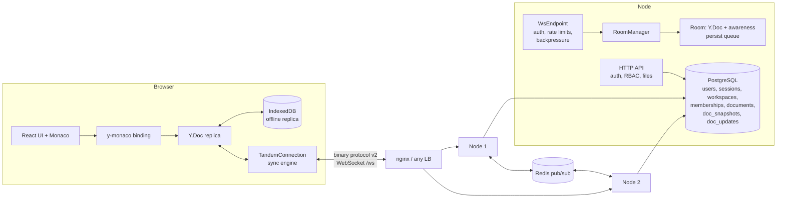

# Architecture

## Packages

| Package | Contents |
| --- | --- |
| `@tandem/protocol` | wire codec (`index.ts`) and the client sync engine (`client.ts`), used by the browser, tests and the load/chaos tools |
| `@tandem/server` | Node.js server: HTTP API, WebSocket endpoint, rooms, persistence, bus, auth |
| `@tandem/client` | React + Vite + Monaco UI |

## Write path of one keystroke

1. Monaco change → y-monaco → `Y.Doc` transaction → the sync engine sends
   `Update(seq)`; the status bar shows "Saving…".
2. Server `WsEndpoint`: rate-limit check, decode/validate, serialized per
   connection.
3. `Room.applyClientUpdate`: server-side role check (viewers rejected),
   structural validation (`Y.decodeUpdate`), size limit, `applyUpdateHealing`
   (see [CORRECTNESS.md](CORRECTNESS.md)). An update whose dependencies are
   still missing is queued for storage raw, so the Ack still means "durable".
4. The document's `update` event fans the *effective* update out to every
   other local client and publishes it on Redis (other nodes apply it).
5. The update is queued; the persist loop writes batches (up to 200 rows per
   INSERT) to `doc_updates` and then sends `Ack(seq)` to the author.
6. After `COMPACT_EVERY` stored updates, compaction merges the log into
   `doc_snapshots` under an advisory lock.

## Read path (opening a document)

`Join` → `roleForDoc` (one query joining documents and memberships) → the
room is loaded if needed: subscribe on Redis first, then read snapshot + log,
then broadcast a node-level `SyncRequest` so that peers send anything not yet
persisted → `Joined(role)` → state-vector handshake → current presence.

## Data model

| Table | Purpose |
| --- | --- |
| `users` | email (unique), name, scrypt hash |
| `sessions` | SHA-256 of the session token, user, expiry |
| `workspaces`, `memberships` | role per user and workspace (`OWNER`/`EDITOR`/`VIEWER`) |
| `documents` | file id, workspace, path (unique per workspace) |
| `doc_snapshots` | compacted Yjs state per document |
| `doc_updates` | append-only log of updates since compaction (author and node recorded) |
| `audit_log` | security-relevant actions (actor, action, target, IP, request id) |
| `schema_migrations` | applied migration versions (migrations run in a transaction under an advisory lock at start-up) |

Loading reads the snapshot and **all** remaining log rows, not "rows after
the snapshot's sequence number": sequence values are assigned before commit,
so a lower number can commit after a higher one; compaction deletes exactly
the rows it merged (see the regression test `compaction.test.ts`).

## Multi-node

* Nodes are stateless apart from in-memory replicas of open documents; any
  node can serve any document, so the load balancer needs no stickiness.
* Redis channels: `tandem:doc:<id>` (updates, awareness, sync request/reply,
  binary) and `tandem:control` (membership changes, document deletions).
* After a Redis reconnect every node re-requests missed state for its open
  documents. Pub/sub is at-most-once even without a disconnect, so the
  periodic sweep is also **anti-entropy**: it merges into the replica what
  the database has and the replica lacks, and asks other nodes for what they
  hold unpersisted.
* Each node persists the updates its own clients send. A periodic
  **durability sweep** (default 15 s, and before unloading a document)
  writes anything a replica has that the database lacks, covering the case
  where the receiving node died before writing and the author never returns.
* Without `REDIS_URL` the server runs single-node (`LocalBus`).
* Login/registration limits are shared through Redis when it is configured.

What has been measured: two nodes + Redis on one 2-vCPU machine, up to
1,000 clients ([PERFORMANCE.md](PERFORMANCE.md)). That shows the multi-node
path is correct under load; it does **not** show throughput scaling with the
number of nodes, because both nodes, the database, Redis and the load
generator shared the same two cores.

## Observability

JSON logs (one line per event, `requestId` on HTTP, connection id on
WebSocket); `X-Request-Id` accepted or generated and returned; Prometheus
text at `/metrics`: connections, users, documents, messages in/out by type,
persistence/ack/HTTP/DB/Redis/compaction/sweep latency histograms, queue
bytes, rate-limit/backpressure/stale-connection/protocol-error counters,
repairs, process CPU, RSS, heap and event-loop lag p99.

## Security boundaries

See [SECURITY.md](SECURITY.md). In short: identity from the session cookie
only; role from the database on join and pushed on change; every update
checked against the role; presence identity overwritten by the server;
origin checks against CSRF and cross-site WebSocket hijacking; no code
execution on the server.
