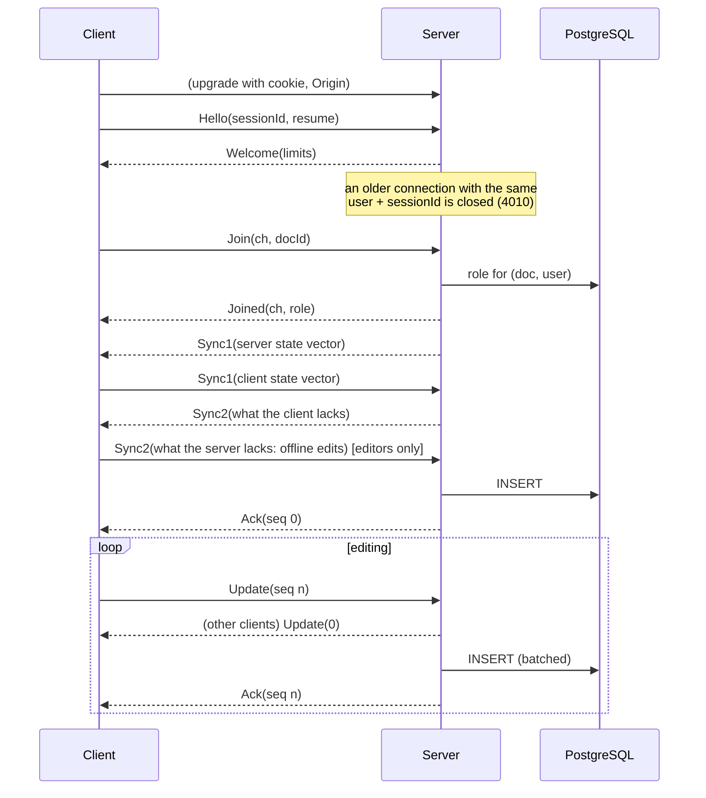

# Wire protocol (version 2)

Implementation: `packages/protocol/src/index.ts` (codec, shared by browser and
server), `packages/protocol/src/client.ts` (client state machine),
`packages/server/src/ws.ts` (connections) and `rooms.ts` (documents).
Correctness argument and tests: [CORRECTNESS.md](CORRECTNESS.md).

## Transport

* One WebSocket per browser tab at `/ws`, authenticated by the session cookie
  during the HTTP upgrade (`401` without a valid session, `403` for a foreign
  `Origin`, `503` while the server shuts down or is at `MAX_CONNECTIONS`).
* Binary frames only. Each frame: `[u8 version = 2][u8 type][payload]`.
  Integers are lib0 varUints, strings are length-prefixed UTF-8 (validated),
  byte arrays are length-prefixed. Text frames close the connection.
* A connection multiplexes documents through **channels**: the client picks a
  channel number per opened document (`Join`); every document message carries
  it. Channel 0 means "the whole connection".

## Messages

| Type | Name | Direction | Payload | Meaning |
| ---: | --- | --- | --- | --- |
| 13 | Hello | C→S | sessionId, resume | **must be the first message.** `sessionId` (`[A-Za-z0-9_-]{8,64}`) identifies the client instance across reconnects; `resume` counts its reconnect attempts |
| 14 | Welcome | S→C | connectionId, heartbeatMs, maxMessageBytes, msgRatePerSec, byteRatePerSec, byteBurst | handshake answer: the limits this server enforces, so the client can pace itself (it uses 80 % of them) |
| 1 | Join | C→S | ch, docId | open a document on channel `ch` |
| 2 | Joined | S→C | ch, docId, role | opened; the role is decided by the server (1 viewer, 2 editor, 3 owner) |
| 3 | Leave | C→S | ch | close the channel |
| 4 | Sync1 | both | ch, state vector | "this is what I have" |
| 5 | Sync2 | both | ch, update | "this is what you were missing" |
| 6 | Update | both | ch, seq, update | incremental change; `seq` > 0 from clients (request id), 0 from the server |
| 7 | Ack | S→C | ch, seq | update `seq` (or the client's Sync2 when `seq` = 0) is **committed to PostgreSQL** |
| 8 | Awareness | both | ch, payload | presence (cursor, selection, user) in y-protocols awareness encoding |
| 9 | Error | S→C | ch, code, ref, message | structured error; `ref` is the `seq` of the refused Update (0 if not about one) |
| 10/11 | Ping/Pong | both | nonce | liveness |
| 12 | RoleChanged | S→C | ch, role | the user's role changed while connected |
| 15 | Fragment | both | id, index, count, bytes | one part of a Sync2 or Update larger than one frame (≤ 256 KiB per part) |

Error codes: 1 BadMessage (connection closed), 2 Unauthorized, 3 Forbidden,
4 NotFound (also used for "no access", so documents cannot be enumerated),
5 RateLimited, 6 TooLarge, 7 Internal, 8 ChannelInUse, 9 Overloaded,
10 UnsupportedVersion.

WebSocket close codes: 4000 protocol error, 4001 unauthorized (the client
stops reconnecting), 4008 rate limited, 4009 send buffer full
(backpressure), 4010 superseded by a newer connection of the same session,
4011 no Hello within the handshake timeout, 1001 server shutdown, 1013 try
again later (inbound queue full, global budget exhausted).

## Versioning

The version byte is checked on every frame. A frame of another version is
answered with an `Error(UnsupportedVersion)` **encoded in the sender's own
version** where that format is known (version 1), then the connection is
closed with 4000; the browser shows "the app was updated, reload". A new
message type or a changed payload requires a new version number.

## Limits

Enforced by the decoder and the server; the per-connection rates are
announced in Welcome.

| Limit | Value |
| --- | --- |
| frame | 1 MiB (larger Sync2/Update are fragmented) |
| reassembled message | `MAX_DOCUMENT_BYTES` + 1 MiB at the server, 64 MiB at the client; fragments must arrive in order, uninterrupted |
| document | `MAX_DOCUMENT_BYTES` (8 MiB encoded) |
| awareness | 16 KiB, ≤ 4 Yjs client ids per connection and document, identity rewritten by the server |
| channels per connection | 64; document id `[A-Za-z0-9_-]{1,64}` |
| messages | 200/s, burst 400 (`MSG_RATE_PER_SEC`, `MSG_BURST`) |
| bytes | 1 MiB/s, burst 4 MiB (`BYTE_RATE_PER_SEC`, `BYTE_BURST`) |
| document operations (Update, Sync2) | 100/s, burst 300 (`OP_RATE_PER_SEC`, `OP_BURST`) |
| inbound queue (received, not yet handled) | 1,000 messages / 4 MiB per connection, then close 1013 |
| outbound queue | flow-controlled against the socket buffer; > 16 MiB queued → close 4009; all sockets together ≤ 512 MiB, partially reassembled messages ≤ 256 MiB |
| handshake | Hello within 10 s |
| heartbeat | the server sends a WebSocket ping every `HEARTBEAT_MS` (30 s) and terminates a socket that has not answered by the next tick; the client sends Ping every 20 s and reconnects after 2.5 intervals without receiving anything |

Unknown types, wrong version, truncated fields, invalid UTF-8 and trailing
bytes raise `ProtocolError` and close the connection (fuzzed in
`codec.test.ts`).

## Connection lifecycle

**Reconnect:** exponential backoff with jitter (0.5–1.5 ×, capped). Every
open document is re-joined; the Sync1/Sync2 exchange sends exactly what each
side lacks. Duplicates are harmless (CRDT idempotence).

**Client watchdog:** if an update stays unacknowledged for `ackTimeoutMs`
(30 s) the client reconnects (recovers a lost frame without a disconnect);
every `resyncIntervalMs` (60 s) it sends a fresh Sync1 (anti-entropy).

**Graceful shutdown:** the server stops accepting upgrades (503), flushes
pending writes, closes sockets with 1001, and after `SHUTDOWN_GRACE_MS`
terminates what remains. Clients reconnect, to another node if behind a
load balancer.

## Delivery guarantees

* **Convergence**: content is a Yjs CRDT; the same set of updates in any
  order, any number of times, yields the same document. No last-write-wins.
* **No silent loss**: an edit counts as *unsaved* until its Ack, which is
  sent only after the update is committed. Updates the server cannot
  integrate yet (missing dependencies) are stored raw before the Ack. If the
  connection drops, unacknowledged edits remain in the client replica (and
  in IndexedDB in the browser) and are sent by the next handshake.
* **Server failures**: a failed database write stays queued and is retried
  with backoff (no Ack meanwhile). A crash loses only unacknowledged
  in-memory state, which the clients still hold. Updates relayed from
  another node are also written by the durability sweep.
* **Multi-node**: Redis pub/sub relays updates between nodes at most once;
  a lost relay is repaired by the anti-entropy sweep (DB → replica, and a
  SyncRequest to the other nodes).
* **Ack ordering**: an update that adds nothing new is acknowledged once
  everything queued before it is durable.
